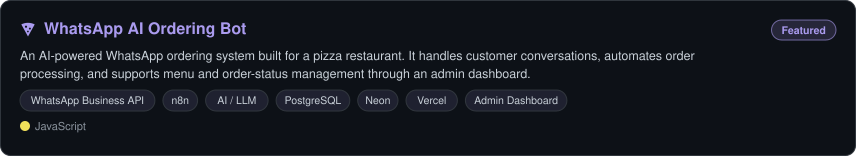
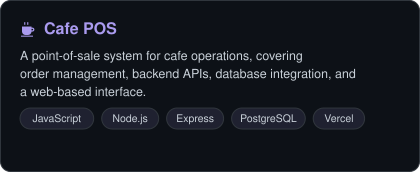
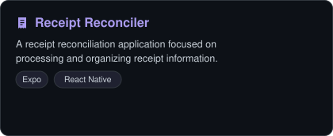
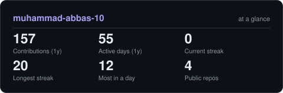

<!-- BANNER: animated terminal profile. Generated by scripts/banner/generate.py
     (~0.9 MB each). Bump BANNER_VERSION there and the ?v paths here if you regenerate. -->
<picture>
  <source media="(prefers-color-scheme: dark)"  srcset="assets/banner-dark.v2.svg">
  <source media="(prefers-color-scheme: light)" srcset="assets/banner-light.v2.svg">
  
</picture>

 

<!-- NAME / TAGLINE: animated typing -->

 

&nbsp;&nbsp;
&nbsp;&nbsp;
&nbsp;&nbsp;
&nbsp;&nbsp;

 

---

## about me

Hi, I'm **Muhammad Abbas Bajwa**, a Computer Science student at **FAST NUCES Peshawar**.
I like turning ideas into working software, especially AI-powered apps, agentic systems and automation that solve real problems.

- 🎓 **CS student at FAST NUCES Peshawar**, learning by building and shipping.
- 💼 **Intern at Virtiqo**, putting what I learn into real-world work.
- 🤖 **Focused on AI and agentic systems:** LLM-powered apps, n8n automations and tools that plug into real workflows.
- 🛠️ **Building practical projects:** a WhatsApp AI ordering bot, a cafe POS system and a receipt reconciliation app.
- 🌱 **Always learning:** Python, C++, machine learning and full-stack web development.
- 🌍 **Open source curious:** interested in contributing and collaborating with other developers.

 

## experience

---

## tech stack

  

---

## featured projects

<!-- Cards are generated by scripts/cards.py from assets/projects.json -->
<a href="https://github.com/muhammad-abbas-10/Pizza-Whatsapp-AI-Bot">
<picture>
  <source media="(prefers-color-scheme: dark)"  srcset="assets/card-whatsapp-ai-ordering-bot-dark.svg">
  <source media="(prefers-color-scheme: light)" srcset="assets/card-whatsapp-ai-ordering-bot-light.svg">
  
</picture>
</a>

<a href="https://github.com/muhammad-abbas-10/Cafe-POS">
<picture>
  <source media="(prefers-color-scheme: dark)"  srcset="assets/card-cafe-pos-dark.svg">
  <source media="(prefers-color-scheme: light)" srcset="assets/card-cafe-pos-light.svg">
  
</picture>
</a>
<picture>
  <source media="(prefers-color-scheme: dark)"  srcset="assets/card-receipt-reconciler-dark.svg">
  <source media="(prefers-color-scheme: light)" srcset="assets/card-receipt-reconciler-light.svg">
  
</picture>

---

## github activity

<!-- Generated by scripts/cards.py into this repo. Deliberately NOT
     github-readme-stats / streak-stats: shared public instances go down and
     take the whole section with them. -->
<picture>
  <source media="(prefers-color-scheme: dark)"  srcset="assets/card-stats-dark.svg">
  <source media="(prefers-color-scheme: light)" srcset="assets/card-stats-light.svg">
  
</picture>

 

<picture>
  <source media="(prefers-color-scheme: dark)"  srcset="assets/card-activity-dark.svg">
  <source media="(prefers-color-scheme: light)" srcset="assets/card-activity-light.svg">
  
</picture>

---

Built by <a href="https://github.com/muhammad-abbas-10">Muhammad Abbas Bajwa</a> · always learning, always shipping

